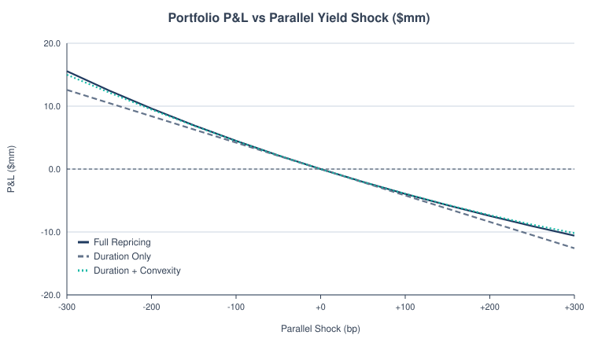
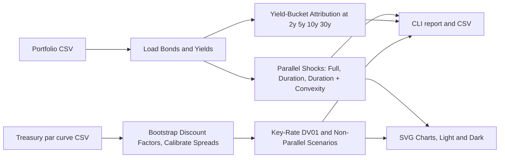
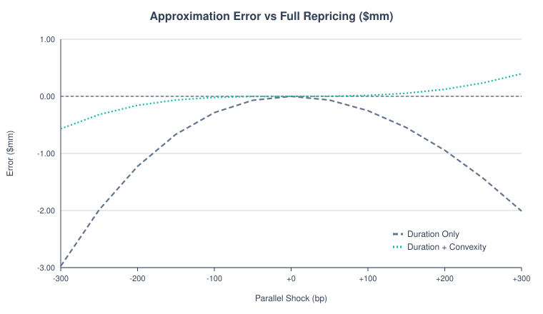
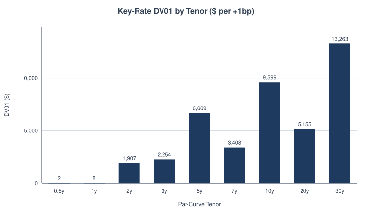
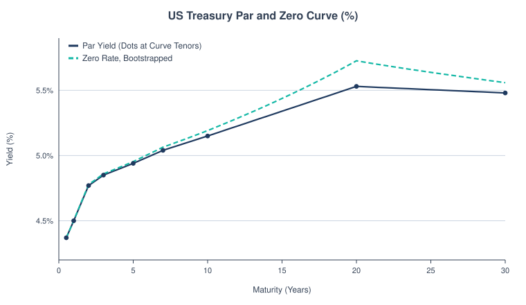
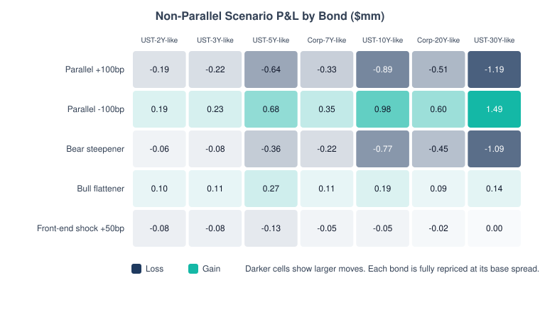
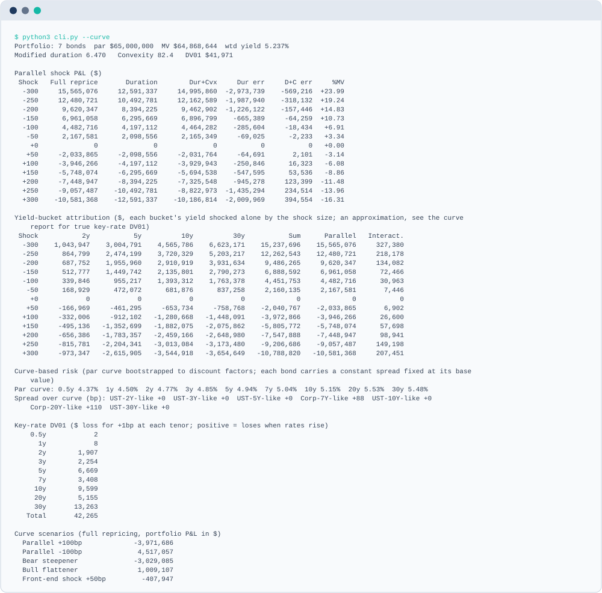
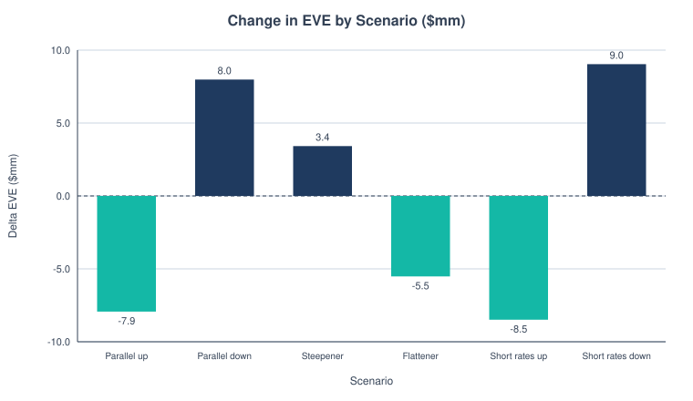

<picture>
  <source media="(prefers-color-scheme: dark)" srcset="docs/banner-dark.svg">
  
</picture>

  

A dependency-free Python tool that measures how a portfolio of fixed-rate bullet bonds responds to interest-rate moves, two ways:

1. **Parallel yield shocks (-300bp to +300bp).** Compares **full repricing** with **duration-only** and **duration + convexity** approximations, reports the approximation error, and attributes P&L to yield buckets (2y / 5y / 10y / 30y).
2. **Curve-based risk.** Bootstraps a US Treasury par curve from FRED into discount factors, reprices every cash flow off it, and reports **key-rate DV01** by tenor plus P&L under **non-parallel scenarios** (bear steepener, bull flattener, front-end shock).

Standard library only (Python 3.9+). No `pip install` needed.

## Contents

- [Hero Chart](#portfolio-pnl-under-parallel-shocks)
- [Results at a Glance](#results-at-a-glance)
- [How It Works](#how-it-works)
- [Quickstart](#quickstart)
- [Charts](#charts)
- [Sample Output](#sample-output)
- [Methodology](#methodology)
- [Bank IRRBB: EVE and NII](#bank-irrbb-eve-and-nii)
- [Optional Richer Plots](#optional-richer-plots)
- [Skills Shown](#skills-shown)
- [Limitations](#limitations)
- [Project Layout](#project-layout)
- [Data Sources](#data-sources)
- [IRRBB Sources and Floors](#irrbb-sources-and-floors)
- [License](#license)
- [Glossary](#glossary)

## Portfolio P&L Under Parallel Shocks

<picture>
  <source media="(prefers-color-scheme: dark)" srcset="docs/pnl_vs_shock-dark.svg">
  
</picture>

*Full repricing against the duration-only and duration + convexity approximations, for a 7-bond sample portfolio.*

## Results at a Glance

| Measure | Value (Sample Portfolio) |
|---|---:|
| Market Value / Modified Duration / Convexity | \$64,868,644 / 6.470 / 82.4 |
| Total Key-Rate DV01 (Curve) | \$42,265 per +1bp |
| Share of Key-Rate DV01 in the 10y and 30y Tenors | 54% |
| Parallel +100bp, Curve-Based Full Repricing | -\$3,971,686 |
| Bear Steepener, Curve-Based | -\$3,029,085 |
| Duration-Only Error at +/-100bp | about 6% of the move |
| Error Reduction from Adding Convexity at +/-100bp | about 15-fold |

## How It Works



## Quickstart

```bash
git clone https://github.com/builtby-hari/BondRateShockAnalyzer && cd BondRateShockAnalyzer && python3 cli.py --curve
```

```bash
python3 cli.py                                    # sample portfolio, -300..+300bp in 50bp steps
python3 cli.py --portfolio my_bonds.csv --step 25 --max-shock 200
python3 cli.py --csv shocks.csv --charts docs     # write CSV and SVG charts (light and dark)
python3 cli.py --curve                            # add curve-based key-rate DV01 and scenarios
python3 cli.py --curve --irrbb                    # also the six Basel IRRBB shock scenarios (USD)
python3 cli.py --curve --irrbb --floor            # same, with the EBA 2018 rate floor (notes where it binds)
python3 cli.py --balance-sheet data/sample_balance_sheet.csv --tier1 90000000   # bank EVE and NII
python3 fetch_curve.py                            # refresh data/treasury_par_curve.csv from FRED
python3 -m unittest discover -v                   # run the tests
python3 -m bondshock.charts                       # regenerate every docs/*.svg and the sample output
```

Portfolio CSV columns (see `data/sample_portfolio.csv`: hypothetical bonds priced off the 2026-10-19 Treasury curve, with the two corporates at the curve plus about 90bp and 110bp):
`id, par, coupon_pct, maturity_yrs, frequency, yield_pct`.

## Charts

Each chart has a light and a dark SVG. The embeds below switch with the reader's color theme.

**Approximation error against full repricing.** Duration-only and duration + convexity P&L minus full repricing, by parallel shock. Convexity removes most of the error on both sides of zero.

<picture>
  <source media="(prefers-color-scheme: dark)" srcset="docs/approx_error-dark.svg">
  
</picture>

**Key-rate DV01 by tenor.** Dollar loss for a +1bp move at each par-curve tenor, with spreads held fixed. The 10y and 30y tenors carry 54% of the total.

<picture>
  <source media="(prefers-color-scheme: dark)" srcset="docs/krd_by_tenor-dark.svg">
  
</picture>

**Treasury par and zero curve.** Par yields (dots at the input tenors) and the zero rates bootstrapped from them. Zero rates sit above par at the long end because the par curve falls between 20y and 30y.

<picture>
  <source media="(prefers-color-scheme: dark)" srcset="docs/treasury_curve-dark.svg">
  
</picture>

**Non-parallel scenario P&L by bond.** Dollar P&L for each curve scenario and bond, in \$mm. Each bond keeps its base spread, so the corporates move with the curve.

<picture>
  <source media="(prefers-color-scheme: dark)" srcset="docs/scenario_heatmap-dark.svg">
  
</picture>

## Sample Output

<picture>
  <source media="(prefers-color-scheme: dark)" srcset="docs/sample-output-dark.svg">
  
</picture>

<details>
<summary>Full Output</summary>

```
Portfolio: 7 bonds  par $65,000,000  MV $64,868,644  wtd yield 5.237%
Modified duration 6.470   Convexity 82.4   DV01 $41,971

Parallel shock P&L ($)
 Shock   Full reprice       Duration        Dur+Cvx     Dur err     D+C err     %MV
  -300     15,565,076     12,591,337     14,995,860  -2,973,739    -569,216  +23.99
  -250     12,480,721     10,492,781     12,162,589  -1,987,940    -318,132  +19.24
  -200      9,620,347      8,394,225      9,462,902  -1,226,122    -157,446  +14.83
  -150      6,961,058      6,295,669      6,896,799    -665,389     -64,259  +10.73
  -100      4,482,716      4,197,112      4,464,282    -285,604     -18,434   +6.91
   -50      2,167,581      2,098,556      2,165,349     -69,025      -2,233   +3.34
    +0              0              0              0           0           0   +0.00
   +50     -2,033,865     -2,098,556     -2,031,764     -64,691       2,101   -3.14
  +100     -3,946,266     -4,197,112     -3,929,943    -250,846      16,323   -6.08
  +150     -5,748,074     -6,295,669     -5,694,538    -547,595      53,536   -8.86
  +200     -7,448,947     -8,394,225     -7,325,548    -945,278     123,399  -11.48
  +250     -9,057,487    -10,492,781     -8,822,973  -1,435,294     234,514  -13.96
  +300    -10,581,368    -12,591,337    -10,186,814  -2,009,969     394,554  -16.31

Yield-bucket attribution ($, each bucket's yield shocked alone by the shock size; an approximation, see the curve report for true key-rate DV01)
 Shock           2y           5y          10y          30y           Sum      Parallel   Interact.
  -300    1,043,947    3,004,791    4,565,786    6,623,171    15,237,696    15,565,076     327,380
  -250      864,799    2,474,199    3,720,329    5,203,217    12,262,543    12,480,721     218,178
  -200      687,752    1,955,960    2,910,919    3,931,634     9,486,265     9,620,347     134,082
  -150      512,777    1,449,742    2,135,801    2,790,273     6,888,592     6,961,058      72,466
  -100      339,846      955,217    1,393,312    1,763,378     4,451,753     4,482,716      30,963
   -50      168,929      472,072      681,876      837,258     2,160,135     2,167,581       7,446
    +0            0            0            0            0             0             0           0
   +50     -166,969     -461,295     -653,734     -758,768    -2,040,767    -2,033,865       6,902
  +100     -332,006     -912,102   -1,280,668   -1,448,091    -3,972,866    -3,946,266      26,600
  +150     -495,136   -1,352,699   -1,882,075   -2,075,862    -5,805,772    -5,748,074      57,698
  +200     -656,386   -1,783,357   -2,459,166   -2,648,980    -7,547,888    -7,448,947      98,941
  +250     -815,781   -2,204,341   -3,013,084   -3,173,480    -9,206,686    -9,057,487     149,198
  +300     -973,347   -2,615,905   -3,544,918   -3,654,649   -10,788,820   -10,581,368     207,451

Curve-based risk (par curve bootstrapped to discount factors; each bond carries a constant spread fixed at its base value)
Par curve: 0.5y 4.37%  1y 4.50%  2y 4.77%  3y 4.85%  5y 4.94%  7y 5.04%  10y 5.15%  20y 5.53%  30y 5.48%
Spread over curve (bp): UST-2Y-like +0  UST-3Y-like +0  UST-5Y-like +0  Corp-7Y-like +88  UST-10Y-like +0  Corp-20Y-like +110  UST-30Y-like +0

Key-rate DV01 ($ loss for +1bp at each tenor; positive = loses when rates rise)
    0.5y            2
      1y            8
      2y        1,907
      3y        2,254
      5y        6,669
      7y        3,408
     10y        9,599
     20y        5,155
     30y       13,263
   Total       42,265

Curve scenarios (full repricing, portfolio P&L in $)
  Parallel +100bp             -3,971,686
  Parallel -100bp              4,517,057
  Bear steepener              -3,029,085
  Bull flattener               1,009,107
  Front-end shock +50bp         -407,947

Effective duration 6.516   effective convexity 83.7  (full repricing off the curve, +/-10bp)
```

</details>

## Methodology

Duration and convexity are the standard shortcuts for how a bond's value moves with yield. They are exact for infinitesimal moves and drift for large ones. Seeing that drift on a plain bullet bond builds the intuition needed for MBS pricing, where effective duration and convexity (and the negative convexity from prepayment) are the main risk numbers. Key-rate attribution shows which part of the curve a portfolio is exposed to. This project is the clean, no-optionality baseline for that work.

Per bond, with `f` coupons per year, `n = maturity * f` periods, per-period
cash flow `CF_k = 100 * c / f` (plus 100 at `k = n`), and yield `y`
(nominal annual, compounded `f` times a year):

| Item | Formula |
|---|---|
| Price (per 100) | $P = \sum_k CF_k / (1 + y/f)^k$ |
| Macaulay duration | $\sum_k (k/f) \cdot PV(CF_k) / P$ |
| Modified duration | $D = \text{Macaulay} / (1 + y/f)$ |
| Convexity | $C = (1/P) \sum_k CF_k \cdot k(k+1) / (f^2 (1 + y/f)^{k+2})$ |
| Duration-only P&L | $\Delta MV = -D \cdot MV \cdot \Delta y$ |
| Duration + convexity P&L | $\Delta MV = MV \cdot (-D \cdot \Delta y + \tfrac{1}{2} C \cdot \Delta y^2)$ |
| Full repricing P&L | $\Delta MV = MV(y + \Delta y) - MV(y)$, with $MV = par \cdot P / 100$ |
| DV01 | $MV \cdot D / 10{,}000$ |

**Yield-bucket attribution.** Key tenors are 2, 5, 10 and 30 years. A bond with maturity
`m` between two key tenors loads on both with triangular weights (1 at its own
tenor, falling linearly to 0 at the neighbor); maturities at or below 2y load
fully on 2y and at or above 30y fully on 30y. Weights always sum to 1. To
attribute P&L to bucket `i`, shock only that bucket by `dy`: each bond's yield
moves by `w_i(m) * dy`, then it is fully repriced. Because the weights sum to 1,
shocking all buckets together is a parallel shock, so the bucket P&Ls sum to
the parallel P&L up to a small cross-term (**interaction**, which is
convexity: the price curve is not linear in the yield shift). The CLI and CSV
report that residual explicitly. This shocks each bond's own yield, so it approximates
key-rate risk. The curve-based method below is the true version. The attribution chart is
`docs/attribution.svg` (dark: `docs/attribution-dark.svg`).

**Curve-based key-rate DV01.** The par curve (semiannual bond-equivalent yields at 0.5, 1, 2, 3, 5, 7,
10, 20 and 30 years) is linearly interpolated to every half-year and bootstrapped:
$DF_k = \big(1 - (y_k/2) \sum_{j<k} DF_j\big) / (1 + y_k/2)$. Each bond is priced as
$\sum_k CF_k \cdot DF_k / (1 + s/2)^k$, where the constant spread `s` is solved once so the bond
reprices exactly to its own yield on the base curve (a Treasury gets about 0bp, a corporate its
credit spread). Key-rate DV01 bumps one par-curve tenor by +/-1bp with triangular weights,
fully reprices every cash flow with `s` held fixed, and takes the central difference. DV01 is the
dollar **loss** for +1bp, so a long bond is positive. This matches the DV01 in the summary line.
Scenarios shift the whole par curve by a piecewise-linear shape and fully reprice. The zero curve
in the chart is $z_k = 2\big(DF_k^{-1/k} - 1\big)$ at each half-year.

**Conventions.** Bonds are valued on a coupon date (no accrued interest, no day
count), yields are per-bond and shift one-for-one (no spread or curve model),
and `maturity` must be a whole number of coupon periods.

## Bank IRRBB: EVE and NII

This turns the Basel shock scenarios into a bank-level view: repricing gap, change in economic value of
equity (EVE) and 12-month net interest income (NII) for a balance sheet you supply.

```bash
python3 cli.py --balance-sheet data/sample_balance_sheet.csv --tier1 90000000
python3 cli.py --balance-sheet my_bank.csv --tier1 90000000 --curve my_curve.csv --floor --charts docs
```

`--currency` picks the 2024 Basel calibration (default USD), `--floor` applies the EBA floor, and
`--outlier-pct` changes the screen threshold. `data/sample_balance_sheet.csv` is illustrative: round
numbers for a made-up bank, not real data, with Tier 1 given on the command line.

**Input columns:** `name, side (asset|liability), balance, rate_type (fixed|floating|nmd), rate_pct, months,
core_pct, avg_life_years, beta`. Fixed lines are bullets with semiannual coupons and `months` to maturity.
Floating lines carry the current all-in rate and `months` to the next reset (and between resets).
Non-maturity deposits (nmd) split into a stable core (`core_pct`, a bullet at `avg_life_years`) and an
overnight remainder; `beta` is the share of a shock passed to the deposit rate.

**Method**

1. Gap: balances are slotted by repricing date into 19 standard time buckets (overnight out to 20y+),
   assets less liabilities, with a running total. Core NMD slots at its average life, the rest overnight.
2. EVE: asset cash flows less liability cash flows, discounted on the bootstrapped par curve, base and
   under each of the six shocks (the existing `irrbb_scenarios`, with the optional floor). Delta EVE is
   shown in dollars and as a percent of Tier 1. A floating line is valued as its next coupon plus par at
   the reset.
3. Outlier check: flags any scenario where the EVE loss exceeds 15% of Tier 1, the supervisory outlier
   test level in the Basel Framework (SRP31, from BCBS d368). It is a screen, not advice, and the
   threshold is an input.
4. NII: constant balance sheet over 12 months with an instant shock. Floating lines reprice at their
   reset dates, fixed lines roll once at maturity into the same coupon plus the shock, and NMD rates move
   by beta times the shock from day one. The shock used is the scenario value at the shortest curve tenor.

**Simplifications**

- Cash flows are principal and coupon only: no amortization, prepayment, early withdrawal or optionality.
- EVE uses risk-free discounting with no commercial margin, and NMD is valued as principal only (the
  interest it pays is ignored), so base EVE overstates book equity. Read the change, not the level.
- No NMD caps are built in. Basel limits the core share and average maturity by deposit type (SRP31); I
  could not check those figures against the primary text, so `core_pct` and `avg_life_years` are inputs
  you must set within your supervisor's limits.
- The 19 time buckets and the 15% level are as I know them from BCBS d368 and the Basel Framework SRP31;
  bis.org could not be fetched here, so check them against the text before relying on either.
- One shock per scenario at the short end for NII; no basis risk, no balance growth or mix change, and no
  second-round deposit behavior.

**Sample output** (`python3 cli.py --balance-sheet data/sample_balance_sheet.csv --tier1 90000000`)

```
Bank IRRBB: assets $950,000,000  liabilities $850,000,000  Tier 1 $90,000,000
Scenarios: Basel 2024 USD no floors

Repricing gap ($; non-empty buckets)
Bucket            Assets    Liabilities            Gap     Cumulative
O/N                    0    103,500,000   -103,500,000   -103,500,000
1M-3M         60,000,000              0     60,000,000    -43,500,000
3M-6M        250,000,000     80,000,000    170,000,000    126,500,000
9M-12M                 0    200,000,000   -200,000,000    -73,500,000
2Y-3Y         70,000,000              0     70,000,000     -3,500,000
3Y-4Y        320,000,000    100,000,000    220,000,000    216,500,000
4Y-5Y        250,000,000    154,000,000     96,000,000    312,500,000
5Y-6Y                  0    212,500,000   -212,500,000    100,000,000

EVE sensitivity (base EVE $204,623,474)
Scenario                      EVE      Delta EVE  % Tier 1
Parallel up           196,689,899     -7,933,575     -8.82
Parallel down         212,602,925      7,979,451     +8.87
Steepener             208,044,214      3,420,741     +3.80
Flattener             199,105,725     -5,517,749     -6.13
Short rates up        196,134,674     -8,488,799     -9.43
Short rates down      213,658,062      9,034,589    +10.04
Outlier check (delta EVE loss > 15% of Tier 1): none breach  (a screen, not advice)

12-month NII sensitivity (constant balance sheet, base NII $34,350,000)
Scenario                      NII      Delta NII   % Base
Parallel up            33,900,000       -450,000    -1.31
Parallel down          34,800,000        450,000    +1.31
Steepener              34,683,658        333,658    +0.97
Flattener              33,909,143       -440,857    -1.28
Short rates up         33,754,315       -595,685    -1.73
Short rates down       34,945,685        595,685    +1.73
```

<picture>
  <source media="(prefers-color-scheme: dark)" srcset="docs/eve_by_scenario-dark.svg">
  
</picture>

## Optional Richer Plots

The core is standard library only, and every chart above is hand-written SVG. For matplotlib versions of the five main charts as PNG files:

```bash
pip install -r requirements-extra.txt
python3 plots_mpl.py          # writes docs/mpl/*.png
```

If matplotlib is missing, the script exits with a short message instead of failing. The matplotlib test in the suite is skipped unless the extra is installed.

## Skills Shown

Python · Fixed income · Interest-rate risk · Data visualization

## Limitations

- Option-free bullet bonds only: no calls, prepayments, floaters or credit spread changes. It is not an
  OAS or effective-duration model.
- Curve mode supports semiannual bonds only, and the par curve is linearly interpolated before
  bootstrapping. Production curve construction uses coupon and day-count conventions and smoother
  interpolation. Each bond's spread is held constant when the curve moves.
- Tenors beyond the ends of the par curve use flat extrapolation: the first or last curve yield is held.
- The yield-based attribution shocks each bond's own yield, so it only approximates key-rate risk.
  Use the curve report for true key-rate DV01.
- No accrued interest, day-count conventions, settlement lag or holidays.
- Shocks are instantaneous and static: no carry, roll-down or time passage.
- The sample portfolio is synthetic: hypothetical bonds, not real positions.

**Next steps**

1. Add a callable or prepayable security and compare effective convexity, linking back to the
   MBS cash flow model.
2. Add carry and roll-down to turn the stress into a horizon return.
3. Support other coupon frequencies in curve mode.

## Project Layout

```
bondshock/pricing.py     Bond, price, duration, convexity
bondshock/portfolio.py   CSV loader, shocks, yield-bucket weights, attribution
bondshock/curve.py       par-curve bootstrap, zero rates, spread calibration, key-rate DV01, scenarios
bondshock/irrbb.py       bank IRRBB: balance sheet loader, repricing gap, EVE and NII sensitivity
bondshock/charts.py      hand-written SVG charts (light and dark), sample output, banner
cli.py                   command line interface
fetch_curve.py           refreshes the Treasury par curve from FRED (default urllib User-Agent)
plots_mpl.py             optional matplotlib PNG versions of the main charts
requirements-extra.txt   optional extra (matplotlib)
data/sample_portfolio.csv
data/sample_balance_sheet.csv
data/treasury_par_curve.csv
tests/                   unittest suite
docs/                    generated SVG charts (light and -dark), banner, sample output
docs/mpl/                optional matplotlib PNGs
LICENSE                  MIT
```

## Data Sources

- Treasury par yields: FRED constant-maturity series DGS6MO, DGS1, DGS2, DGS3, DGS5, DGS7, DGS10, DGS20 and DGS30, fetched by `fetch_curve.py` and stored in `data/treasury_par_curve.csv` (as of 2026-10-19).
- `data/sample_portfolio.csv` is synthetic: hypothetical bonds priced off that curve.

## IRRBB Sources and Floors

The formulas, decay x = 4 and the 2016 USD sizes (200/300/150bp)
are from BCBS d368, Annex 2 (checked against the OSFI Guideline reproduction of the Annex; bis.org's
PDF could not be fetched directly). `irrbb_scenarios()` defaults to that 2016 calibration. The July 2024
recalibration (BCBS d578, in force 2026-01-01) is in `IRRBB_2024` as (parallel, short, long) per
currency, from the KPMG Hong Kong summary table; USD becomes 200/300/225bp. Use
`irrbb_scenarios(*IRRBB_2024["USD"])`. Basel leaves post-shock rate floors to national supervisors (any
floor at or below zero); `floor_shape` applies one, with `eba_floor` (-1% rising 5bp a year to 0 at
20y, the EBA 2018 rule) as an example. Floors are not applied by default; `--irrbb --floor` applies `eba_floor` in the CLI and notes each scenario where it binds.

## License

MIT. See `LICENSE`.

## Glossary

| Term | Plain-English Meaning |
|---|---|
| Accrued Interest | Interest that has built up since the last coupon payment, which a buyer usually pays the seller; this project ignores it. |
| Basis Point (bp) | One hundredth of a percentage point, so 100 bp equals 1 percentage point. |
| Bear Steepener | A rate move where long-term rates rise more than short-term rates, like a ramp getting steeper as its top end lifts higher. |
| Bootstrapping | Building a full set of rates one maturity at a time, each step using the last, like climbing a ladder one rung at a time. |
| Bull Flattener | A rate move where long-term rates fall more than short-term rates, which squashes the gap between them. |
| Bullet Bond | A bond that pays interest along the way and returns all the principal in one lump at maturity. |
| Convexity | How much a bond's price-versus-yield curve bends, which corrects the straight-line duration estimate for large rate moves. |
| Coupon | The fixed interest payment a bond makes, usually twice a year, as a percent of face value. |
| Credit Spread | The extra yield a bond pays above a Treasury of the same maturity to cover the risk the issuer defaults, like a higher rate charged to a riskier borrower. |
| Discount Factor | The value today of one dollar received at a future date, so 0.95 means that future dollar is worth 95 cents now. |
| DV01 | The dollar change in a position's value for a one basis point rise in rates. |
| FRED | The Federal Reserve Bank of St. Louis's free database of economic data, including Treasury yields. |
| Front-End Shock | A rate move concentrated in short-term rates, leaving long-term rates mostly unchanged. |
| Key-Rate DV01 | DV01 split by maturity point on the rate curve, showing which part of the curve drives the risk, like a bill broken into line items. |
| Macaulay Duration | The weighted average time, in years, until a bond's cash flows arrive, weighted by their present value. |
| Maturity | The date a bond's principal is repaid, which ends the bond's life. |
| Modified Duration | A rough percent change in a bond's price for a one percentage point move in its yield, a quick sensitivity measure. |
| P&L | Profit and loss; here, the change in a portfolio's value under a rate move, where a negative number is a loss. |
| Par Curve | The line of Treasury yields across maturities, where each yield is the coupon that would price a bond at face value. |
| Parallel Shock | A rate move where every point on the curve shifts by the same amount, like sliding a whole ruler up. |
| Treasury | A bond issued by the US government, used as the benchmark for low-risk interest rates. |
| Yield | The annual return an investor earns by buying at today's price and holding to the end. |
| Zero Rate | The interest rate for a single payment at one future date with nothing paid in between, like a one-time loan rate. |

---

Built by Hari Saravanan · [LinkedIn](https://www.linkedin.com/in/srihari-saravanan)
